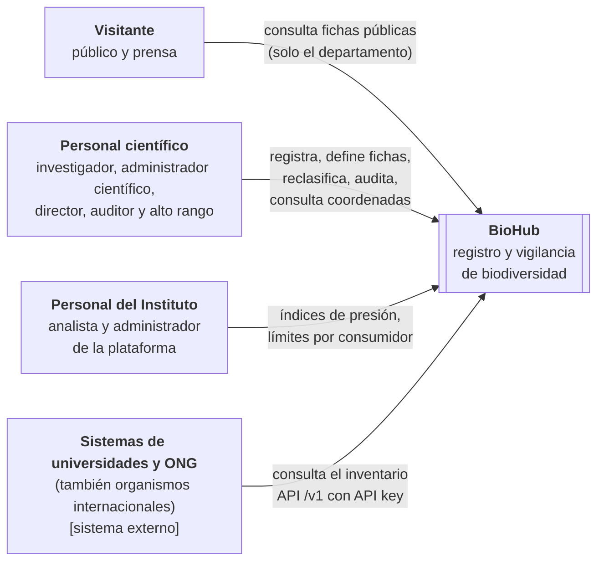
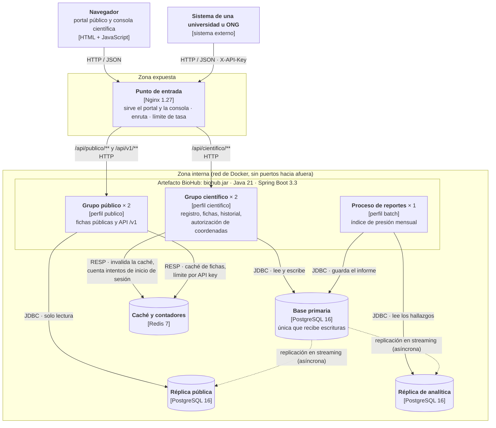

# Arquitectura tal como quedó (C4)

Los diagramas C4 del Entregable 2 no nombraban tecnologías, porque estaban pendientes (P-07). La Sesión 14 pide que el **nivel 2 (contenedores)** muestre la tecnología de cada contenedor y cómo se comunica con los demás. Estos son los diagramas del sistema construido, escritos como código (Mermaid), como recomienda Simon Brown: viven en el repositorio y se revisan en cada pull request. GitHub los dibuja solo.

Lo que cambió frente al Entregable 2 está en [`trazabilidad.md`](trazabilidad.md), secciones 7, 8 y 11.

## Nivel 1 · Contexto

## Nivel 2 · Contenedores

Un solo artefacto (`biohub.jar`) corre en tres roles: científico, público y batch. Solo Nginx publica un puerto hacia afuera (RNF-07).

Qué decisión sostiene cada línea:

| Línea | Requisito |
| --- | --- |
| Solo Nginx está en la zona expuesta | RNF-07 (PR-10) |
| El grupo público nunca toca la primaria | RNF-02, RNF-03 y RNF-04 (PR-02, PR-03) |
| Dos instancias científicas detrás de Nginx | RNF-04 (PR-04) |
| El batch calcula sobre su propia réplica | RNF-09 (PR-13) |
| Nginx llama a los grupos por nombre de servicio, no por dirección | RNF-08 (PR-12) |
| Cada rol entra a la base con su propio usuario | RNF-06 (PR-09) |

## Despliegue

| Nodo (contenedor de Docker) | Cuántos | Imagen |
| --- | --- | --- |
| `nginx` | 1 | `nginx:1.27-alpine` |
| `app-cientifico` | 2 | `biohub` (el mismo `biohub.jar`) |
| `app-publico` | 2 | `biohub` |
| `batch` | 1 | `biohub` |
| `postgres-primaria`, `postgres-replica-publica`, `postgres-replica-analitica` | 1 cada una | `postgres:16` |
| `redis` | 1 | `redis:7-alpine` |

Todo se define en `docker-compose.yml` (infraestructura como código, S26) y se levanta con `docker compose up --build --wait`.
