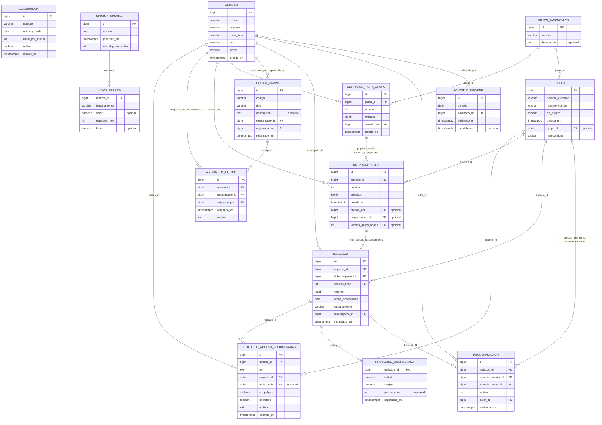

# Modelo de datos real · BioHub

Este diagrama **se generó a partir de la base de datos funcionando** (`information_schema` de PostgreSQL 16, con las migraciones V1 a V9 aplicadas). No es un dibujo a mano: así es la base hoy.

GitHub dibuja el diagrama solo. En otro visor, copie el bloque en https://mermaid.live.

## Las 15 tablas

| Tabla | Para qué | Migración | Regla importante |
| --- | --- | --- | --- |
| `usuario` | Personal del Instituto y su rol | V2 | La clave se guarda con BCrypt, nunca en texto |
| `especie` | Catálogo de especies | V3, V8 | `en_peligro` decide quién ve sus coordenadas; `grupo_id` y `hereda_ficha` (V8) |
| `definicion_ficha` | Cada **versión** de la ficha de una especie (atributos en JSONB) | V3, V8 | No se edita ni se borra: un cambio es una versión nueva (RNF-01) |
| `grupo_taxonomico` | Grupos como Primates o Aves | V8 | Nombre único |
| `definicion_ficha_grupo` | Cada versión de la ficha de un grupo | V8 | Al cambiar, se copia a las especies que heredan (`grupo_origen_id`, `version_grupo_origen`) |
| `hallazgo` | Cada registro de campo | V3_1 | Apunta a la versión exacta de la ficha con que se validó; solo guarda el **departamento** |
| `protegido.coordenada` | Latitud y longitud exactas | V3_1 | Otro **esquema**: `app_publico` y `app_batch` no pueden ni entrar (PR-09) |
| `protegido.acceso_coordenadas` | Cada consulta de coordenadas, permitida o negada | V5 | Solo se agrega; el auditor la consulta |
| `reclasificacion` | Historial de cambios de especie | V4 | Triggers y permisos impiden `UPDATE`, `DELETE` y `TRUNCATE` (RNF-05) |
| `consumidor` | Universidades y ONG de la API `/v1` | V6 | Guarda la **huella** SHA-256 de la clave, no la clave |
| `informe_mensual` y `indice_presion` | Informes del batch | V7 | Un informe por mes; nunca uno vacío |
| `solicitud_informe` | Pedidos del analista al batch | V7 | Estados PENDIENTE, ATENDIDA, SIN_DATOS |
| `equipo_campo` | Drones, cámaras, sensores | V9 | `responsable_id` es **NOT NULL** (HU-03, criterio 4); solo se puede cambiar el responsable |
| `asignacion_equipo` | Historial de responsables | V9 | Solo se agrega |

## Diferencias con el diagrama del Entregable 2

| Entregable 2 | Base real | Por qué |
| --- | --- | --- |
| Ubicación pública: "región o departamento" (RF-09) | Solo `departamento` (33 valores, los mismos en la validación y en el mapa) | Región es ambigua (natural, administrativa…). El departamento cumple RF-09 y es lo que entiende un visitante |
| Ficha por especie **o** grupo | `definicion_ficha` y `definicion_ficha_grupo`, con copia a las especies que heredan | Así el hallazgo sigue apuntando a una versión fija de la ficha de **su** especie (decisión del paquete 14) |
| Un solo rol por usuario (P-25) | `usuario.rol` | Igual que en el Entregable 2 |
| Repositorios de usuarios e informes (C-1, C-2) y escritura y lectura de coordenadas separadas (C-3) | `RepositorioInformes`, `RepositorioUsuarios`, `EscrituraCoordenadas` y `LecturaCoordenadas` | Se aprobaron las tres correcciones propuestas |
| Base primaria con dos réplicas | 1 primaria + réplica pública + réplica de analítica, con replicación asíncrona | Igual que en el Entregable 2 (consistencia eventual, medida en milisegundos) |

## Usuarios de base de datos (privilegios mínimos, T-14)

| Usuario | Lo usa | Puede |
| --- | --- | --- |
| dueño (`DB_DUENO`) | Solo Flyway, al arrancar el grupo científico | Todo. Su clave va solo en `.env` |
| `app_cientifico` | Grupo científico | Leer y escribir lo suyo; **no** puede cambiar ni borrar coordenadas ni el historial, ni borrar hallazgos o fichas |
| `app_publico` | Grupo público (réplica pública) | Solo leer, y nada del esquema `protegido` ni la tabla de usuarios |
| `app_batch` | Batch (réplica de analítica) | Solo leer hallazgos e informes, y escribir informes en la primaria por un pool aparte |

Lo comprueba `PermisosBaseDeDatosIT` (PR-09), conectándose como cada usuario.
